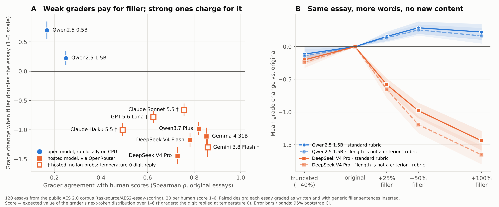

# Do LLM essay graders pay for words that say nothing?

**Result.** Small graders give a higher grade to an essay padded with content-free filler. Capable graders
(Claude, GPT, Gemini, DeepSeek, Gemma, Qwen 3.7) do the opposite: they mark the same essay down by
0.7–1.4 points on a 1–6 scale. That is **2–9× the penalty they give for deleting 40% of the essay's
actual argument.** Neither group is length-neutral. Telling the grader that length is not a criterion
changes almost nothing.



## Why this matters

LLM-as-a-judge is used to grade students, to score model outputs in evaluations, and to supply reward
signals for training. A grader that reacts to length instead of content can be gamed: a student, or a
model being optimised against the grader, learns to pad. That is a reward-hacking problem. I build
production LLM graders for English proficiency (IELTS-style rubrics, PTE practice), where the same
failure decides a learner's score, so I wanted a clean, reproducible measurement rather than an anecdote.

## Design

A paired counterfactual. Each essay is graded several times, and only one thing changes between
versions, so any change in grade is caused by that edit and not by differences between essays.

| Version | What changes |
|---|---|
| original | the essay as written |
| +25% / +50% / +100% filler | generic sentences inserted at even intervals ("There are many things to think about when looking at this issue."). No claim, reason or evidence is added. |
| self-repeat +100% | padded with copies of the essay's own sentences. This keeps the student's errors, so the filler's cleaner grammar cannot explain the result. |
| truncated −40% | only the first 60% of sentences kept. Positive control: a grader that reads content should mark this down. |

- **Data.** 120 essays from the public AES 2.0 corpus
  ([`tasksource/AES2-essay-scoring`](https://huggingface.co/datasets/tasksource/AES2-essay-scoring),
  CC BY-NC 4.0, pinned revision), 20 at each human score from 1 to 6, seed 0.
- **Graders.** 11 models: 2 small open models run locally on CPU (Qwen2.5 0.5B / 1.5B Instruct) and
  9 hosted models through OpenRouter.
- **Rubrics.** A standard holistic 1–6 rubric, and the same rubric with one added instruction: *"Length is
  not a criterion … treat generic sentences that add no specific point as a weakness."*
- **Score.** Where the model exposes log-probs, the score is the expected value of its next-token
  distribution over `1`–`6`: one deterministic pass, no sampling. Claude, GPT and Gemini expose no
  log-probs, so for them the score is the digit they reply with at temperature 0 (marked †).
- **Statistics.** Mean paired difference from the original with a 95% bootstrap CI over essays, and a
  Wilcoxon signed-rank test in `results/summary.json`.

11 graders × 2 rubrics × 6 versions × 120 essays = 15,840 grades.

## Results

| Grader | Prompt | ρ vs human | Δ +25% filler | Δ +50% | Δ +100% | scored higher at +100% | Δ self-repeat +100% | Δ truncated −40% |
|---|---|---|---|---|---|---|---|---|
| Qwen2.5 0.5B | length-aware | 0.20 | +0.55 [+0.44, +0.67] | +0.66 [+0.52, +0.81] | +0.70 [+0.55, +0.86] | 75% | +0.29 [+0.19, +0.40] | -0.12 [-0.25, +0.02] |
| Qwen2.5 0.5B | standard | 0.17 | +0.51 [+0.40, +0.61] | +0.64 [+0.51, +0.77] | +0.70 [+0.55, +0.85] | 75% | +0.25 [+0.15, +0.35] | -0.11 [-0.23, +0.01] |
| Qwen2.5 1.5B | length-aware | 0.29 | +0.14 [+0.07, +0.21] | +0.26 [+0.17, +0.34] | +0.17 [+0.05, +0.28] | 50% | -0.58 [-0.67, -0.49] | -0.14 [-0.24, -0.04] |
| Qwen2.5 1.5B | standard | 0.25 | +0.15 [+0.09, +0.23] | +0.29 [+0.20, +0.38] | +0.22 [+0.10, +0.35] | 50% | -0.58 [-0.68, -0.48] | -0.11 [-0.22, -0.01] |
| Claude Haiku 5.5 † | length-aware | 0.54 | -0.43 [-0.53, -0.34] | -0.78 [-0.88, -0.68] | -1.02 [-1.12, -0.91] | 0% | -0.95 [-1.06, -0.85] | -0.23 [-0.33, -0.13] |
| Claude Haiku 5.5 † | standard | 0.49 | -0.34 [-0.43, -0.25] | -0.68 [-0.78, -0.57] | -1.00 [-1.11, -0.89] | 0% | -0.88 [-0.99, -0.75] | -0.11 [-0.20, -0.02] |
| Claude Sonnet 5.5 † | length-aware | 0.77 | -0.23 [-0.32, -0.16] | -0.33 [-0.41, -0.24] | -0.57 [-0.66, -0.47] | 0% | -0.97 [-1.09, -0.85] | -0.22 [-0.30, -0.14] |
| Claude Sonnet 5.5 † | standard | 0.76 | -0.22 [-0.30, -0.13] | -0.30 [-0.39, -0.21] | -0.66 [-0.77, -0.55] | 0% | -0.85 [-0.97, -0.73] | -0.17 [-0.25, -0.11] |
| DeepSeek V4 Flash | length-aware | 0.79 | -0.52 [-0.61, -0.44] | -0.82 [-0.92, -0.72] | -1.11 [-1.24, -0.98] | 2% | -1.11 [-1.24, -0.99] | -0.31 [-0.38, -0.24] |
| DeepSeek V4 Flash | standard | 0.78 | -0.41 [-0.49, -0.33] | -0.72 [-0.82, -0.63] | -1.17 [-1.30, -1.05] | 2% | -1.23 [-1.33, -1.11] | -0.25 [-0.32, -0.18] |
| DeepSeek V4 Pro | length-aware | 0.68 | -0.65 [-0.78, -0.52] | -1.19 [-1.32, -1.06] | -1.66 [-1.80, -1.52] | 0% | -1.71 [-1.85, -1.57] | -0.24 [-0.33, -0.15] |
| DeepSeek V4 Pro | standard | 0.73 | -0.58 [-0.68, -0.49] | -0.98 [-1.10, -0.85] | -1.44 [-1.59, -1.29] | 2% | -1.51 [-1.66, -1.36] | -0.20 [-0.28, -0.13] |
| Gemini 3.8 Flash † | length-aware | 0.83 | -0.59 [-0.70, -0.48] | -0.92 [-1.05, -0.78] | -1.24 [-1.39, -1.08] | 0% | -1.68 [-1.83, -1.52] | -0.50 [-0.61, -0.39] |
| Gemini 3.8 Flash † | standard | 0.86 | -0.59 [-0.72, -0.47] | -0.98 [-1.13, -0.83] | -1.30 [-1.47, -1.13] | 0% | -1.68 [-1.83, -1.52] | -0.62 [-0.72, -0.51] |
| Gemma 4 31B | length-aware | 0.82 | -0.38 [-0.49, -0.28] | -0.91 [-1.06, -0.77] | -1.04 [-1.17, -0.91] | 2% | -1.61 [-1.75, -1.47] | -0.27 [-0.35, -0.20] |
| Gemma 4 31B | standard | 0.85 | -0.35 [-0.46, -0.24] | -0.75 [-0.90, -0.61] | -1.11 [-1.27, -0.96] | 2% | -1.43 [-1.59, -1.27] | -0.30 [-0.38, -0.23] |
| GPT-5.6 Luna † | length-aware | 0.65 | -0.38 [-0.47, -0.28] | -0.50 [-0.59, -0.41] | -0.68 [-0.78, -0.58] | 0% | -1.27 [-1.38, -1.17] | -0.28 [-0.37, -0.20] |
| GPT-5.6 Luna † | standard | 0.62 | -0.38 [-0.47, -0.29] | -0.52 [-0.62, -0.42] | -0.78 [-0.88, -0.68] | 0% | -1.32 [-1.46, -1.20] | -0.33 [-0.42, -0.23] |
| Qwen3.7 Plus | length-aware | 0.81 | -0.33 [-0.39, -0.27] | -0.61 [-0.69, -0.53] | -0.86 [-0.95, -0.76] | 1% | -1.28 [-1.38, -1.18] | -0.27 [-0.32, -0.22] |
| Qwen3.7 Plus | standard | 0.82 | -0.33 [-0.39, -0.27] | -0.64 [-0.73, -0.56] | -0.98 [-1.09, -0.87] | 1% | -1.31 [-1.41, -1.21] | -0.32 [-0.37, -0.27] |

† No log-probs available: score is the digit the model replies with at temperature 0, so per-essay scores are whole numbers and the means are noisier.

ρ is each grader's Spearman correlation with the human scores on the unedited essays. Δ is the mean
change in grade against the original essay, with 95% CI.

1. **Weak graders reward padding.** Qwen2.5 0.5B gave 75% of padded essays a higher grade (+0.70).
   These are the graders someone picks to score cheaply at scale.
2. **Strong graders punish it, and punish it more than missing content.** For a capable grader, doubling
   an essay with generic sentences costs 0.7–1.4 points. Cutting 40% of the essay's reasoning costs
   0.1–0.6. A human examiner would also penalise filler, so the direction is defensible. The size is not:
   these graders treat *saying something vague* as worse than *saying much less*.
3. **It is not about grammar.** For every capable grader, self-repeat padding (which keeps the student's
   own errors) drops the grade as much as the filler does, or more (−0.9 to −1.7). Qwen2.5 0.5B rewards even
   this (+0.25): it is paying for length, not polish.
4. **The instruction does not fix it.** Adding "length is not a criterion" changes the +100% filler effect
   by less than 0.15 points for 10 of 11 graders. The exception, DeepSeek V4 Pro, moves 0.22 further
   into penalising filler.
5. **Why graders lean on length at all.** In this corpus the human score correlates ρ = 0.85 with word
   count. Length is a strong proxy for quality in the data, and that is what a grader can latch onto.

## Limitations

- One essay genre (US secondary-school argumentative essays) and one filler bank of 12 sentences. A
  grader may react differently to topical but empty padding.
- For † graders, scores are whole numbers, so their means are coarser. Their CIs still exclude zero.
- Hosted models change behind the same name, and OpenRouter may route a request to different providers.
  The provider that served each call is recorded in the CSV.
- 120 essays is enough for the large effects here, but not for fine per-score-level comparisons.
- I did not include Qwen2.5 3B: on a 4-core CPU it needed about two more hours. `run.py` will run it.

## Reproduce

```bash
pip install torch --index-url https://download.pytorch.org/whl/cpu
pip install transformers datasets scipy matplotlib pandas
python run.py --n 120 --models Qwen/Qwen2.5-0.5B-Instruct Qwen/Qwen2.5-1.5B-Instruct    # free, ~45 min on 4 CPU cores
OPENROUTER_API_KEY=... python run.py --n 120 --models --api-models deepseek/deepseek-v4-flash \
  google/gemma-4-31b-it qwen/qwen3.7-plus deepseek/deepseek-v4-pro --out results/scores_api.csv
OPENROUTER_API_KEY=... python run.py --n 120 --models --api-models anthropic/claude-haiku-5.5 \
  openai/gpt-5.6-luna google/gemini-3.8-flash anthropic/claude-sonnet-5.5 --out results/scores_frontier.csv
python analyze.py    # writes results/summary.{json,md} and figure.png
```

The hosted runs cost about $8 in total on OpenRouter (November 2026 prices). Every grade is in
`results/scores*.csv`, so `analyze.py` reproduces the table and the figure with no API calls.

| File | Contents |
|---|---|
| `run.py` | essay sampling, the edits, both rubrics, local and API graders |
| `analyze.py` | statistics, table and figure |
| `results/scores*.csv` | every grade: model, prompt, essay, condition, word count, score, provider |
| `results/summary.json` | all statistics, including Wilcoxon p-values |

*Amantu Khan, November 2026.*
